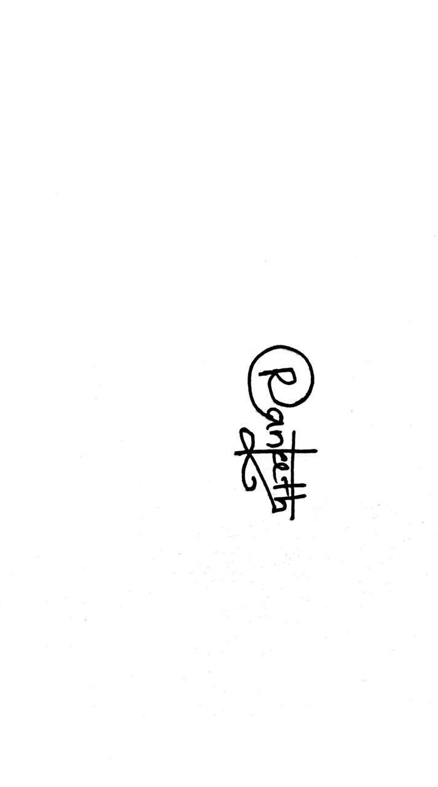

# Client Handover Note

## Campus Lost & Found Portal

**Handover date:** 15 October 2026
**System:** Campus Lost & Found Portal
**Repository:** [GitHub repository](https://github.com/ChenuliR/kdu-lost-found-system)

## 1. Purpose of This Note

This note transfers operational knowledge of the Campus Lost & Found Portal from the development team to the client. It explains what has been delivered, how the system is operated, which services and accounts the client must control, and what should be checked before accepting the handover.

The system provides a central place for students and staff to report lost or found property, search listings, submit claims, and receive claim-status notifications. Authorized administrators can review claims, moderate listings, and monitor portal activity.

## 2. Delivered System

The delivered application includes:

- Authenticated student and staff access.
- Lost and found item posts with categories, dates, locations, descriptions, photographs, and statuses.
- Search and filtering of active listings.
- Claim submission with proof and contact details.
- Claim status tracking: `Pending`, `Approved`, and `Rejected`.
- Notifications for claim submission and claim-status changes.
- User management of their own posts and claims.
- Administrator dashboards for claim review and post moderation.
- Row Level Security policies in Supabase to restrict access to user-owned data and administrator functions.
- System architecture and database diagrams in [Architecture Documentation](architecture.md) and the [Mermaid Diagrams](diagrams/).

## 3. Client Accounts and Ownership

The client should take ownership of the following accounts before production use:

| Account or service | Client responsibility |
|---|---|
| GitHub repository | Maintain repository access, branches, and release history. |
| Supabase project | Own billing, database, authentication, storage configuration, logs, and backups. |
| Production hosting account | Own deployment, domain, environment variables, and deployment logs. |
| Administrator accounts | Approve named administrators and remove access when staff leave. |
| Email/authentication provider | Configure approved sign-in methods and production email settings. |

The development team should not be the only holder of production credentials. Credentials must be transferred through a secure password manager or the provider's official invitation flow. Do not commit `.env` files, passwords, service-role keys, or API tokens to GitHub.

## 4. Deployment Prerequisites

The person performing deployment needs:

- Node.js and npm installed.
- Access to the GitHub repository.
- A Supabase project.
- A production hosting project capable of running a Next.js application.
- A configured production domain, if the client requires a custom domain.

The application currently expects these environment variables:

```env
NEXT_PUBLIC_SUPABASE_URL=https://your-project.supabase.co
NEXT_PUBLIC_SUPABASE_ANON_KEY=your-supabase-anon-key
```

The public Supabase URL and anonymous key may be exposed to the browser. A Supabase service-role key must never be placed in these variables or exposed to the client.

## 5. Deployment Procedure

1. Clone the repository and install dependencies:

   ```bash
   git clone https://github.com/ChenuliR/kdu-lost-found-system.git
   cd kdu-lost-found-system
   npm install
   ```

2. Create the production environment variables in the hosting provider.

3. In the Supabase SQL Editor, run the [Initial Database Schema](initialschema.sql). If the existing project was created from an earlier database version, run the [Claim Review Migration](claim-review-migration.sql) as the required migration instead of manually duplicating its changes.

4. Confirm that Row Level Security is enabled for `posts`, `claims`, `comments`, and `notifications`.

5. Create or invite the first administrator account. Set its Supabase Auth `app_metadata` role to `admin` using the approved server-side or Supabase administrative process. The administrator role must not be stored as ordinary user-editable metadata.

6. Deploy the application:

   ```bash
   npm run build
   npm run start
   ```

   For local development, use `npm run dev` instead.

7. Open the deployed URL and complete the acceptance checks in Section 9.

## 6. Routine Operations

### Daily or weekly administrator tasks

- Review pending claims and check the submitted proof before approving or rejecting them.
- Review flagged or inappropriate posts and remove or moderate them according to campus policy.
- Check that approved claims move the related post to `Claimed`.
- Check notifications when investigating a user support request.
- Confirm that no pending claims are left unattended.

### User claim process

1. A student or staff member opens an active post and submits proof details and contact information.
2. The post owner or administrator reviews the claim.
3. The reviewer approves or rejects the claim and may add comments.
4. The claimant receives a notification of the outcome.
5. When a claim is approved, the post becomes `Claimed` and other pending claims for that post are rejected.

### Content and privacy responsibilities

- Use clear campus guidance for what information users should and should not include in descriptions, proof, and contact fields.
- Remove personal contact information from public posts where it is not needed.
- Process claims only for legitimate ownership verification and do not disclose claimant information unnecessarily.
- Define a retention policy for old posts, rejected claims, images, and user accounts.
- Provide a support contact for account, claim, and moderation issues.

## 7. Backup, Security, and Recovery

The client is responsible for confirming that the Supabase project has:

- A production backup and recovery plan.
- Appropriate database and storage retention settings.
- Multi-factor authentication for project owners and administrators.
- Least-privilege access for staff and developers.
- Monitoring of authentication, database, and hosting logs.
- A documented process for revoking access and rotating credentials.

Before production launch, record the following outside the source repository:

- Production URL and domain owner.
- Supabase project owner and billing contact.
- Hosting project owner and deployment contact.
- Named administrators and date of last access review.
- Backup schedule and recovery contact.
- Approved support and escalation contacts.

## 8. Known Operational Boundaries

- The application requires a reachable Supabase project and correctly configured environment variables.
- Administrator access is controlled by the Supabase Auth `app_metadata.role` value.
- Database schema and Row Level Security changes must be applied through a reviewed SQL migration or the supplied SQL scripts.
- The client must configure production authentication and email behaviour in Supabase; these settings are provider-specific and are not controlled by the application source alone.
- The client should test image storage and image access in the selected production environment before launch.

## 9. Handover Acceptance Checklist

The client and development team should complete this checklist together:

- [ ] Client has access to the GitHub repository.
- [ ] Client owns or has been invited to the Supabase project.
- [ ] Client owns or has been invited to the production hosting project.
- [ ] Production environment variables are configured securely.
- [ ] Database schema and migrations have been applied successfully.
- [ ] Row Level Security policies have been verified.
- [ ] At least one administrator account has been created and tested.
- [ ] A normal user can register or sign in.
- [ ] A user can create a lost or found post.
- [ ] A user can search for and view an active post.
- [ ] A second user can submit a claim.
- [ ] The post owner or administrator can review the claim.
- [ ] Approval changes the post to `Claimed` and sends the expected notification.
- [ ] Rejection sends the expected notification.
- [ ] Moderation actions work for authorized administrators only.
- [ ] Production domain, authentication email, image handling, backups, and monitoring have been tested.
- [ ] Support, retention, and escalation procedures have been agreed with the client.

## 10. Reference Documentation

- [Project setup guide](../README.md)
- [Architecture overview](architecture.md)
- [Mermaid system and database diagrams](diagrams/)
- [Initial database schema](initialschema.sql)
- [Claim review migration](claim-review-migration.sql)
- [User journey flows](user-journey-flows.md)
- [Definition of done](definition-of-done.md)

## 11. Sign-Off

By signing below, the client confirms that the production access, operational responsibilities, acceptance checks, and known boundaries described in this note have been reviewed.

| Role | Name | Signature | Date |
|---|---|---|---|
| Client representative | H. A. J. R. Wijesinghe |  | 2026-10-15 |
| Development representative | N. A. D. Mahmoor |  | 2026-10-15 |
