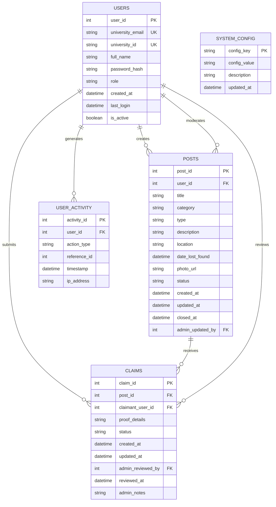

# Entity Relationship Diagram (ERD)

This diagram represents the proposed entities and relationships for the Campus Lost & Found Portal.



## Key Relationships

- One user can create multiple posts.
- One user can submit multiple claims.
- One post can receive multiple claims.
- Users can generate multiple activity records.
- Administrators can moderate posts and review claims.
```

